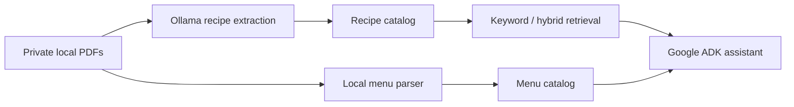

# Dietitian AI

A recipe and menu assistant that retrieves records from dietitian PDFs and preserves source references, portions, and alternative menu options.

This portfolio snapshot contains the application code, deterministic tests, and synthetic demo catalogs. Private diet documents, extracted records, embeddings, session history, local path mappings, and credentials are excluded.

## What it does

- Extracts structured recipes with a local Ollama model and Pydantic validation.
- Parses lunch and dinner options locally and presents them in a combined evening-menu catalog, retaining each original meal label.
- Supports keyword retrieval and BM25/vector hybrid search with Gemini embeddings.
- Validates embedding counts, dimensions, model identity, and catalog fingerprints before caching; falls back to keyword search when semantic retrieval fails.
- Uses Google ADK tools to list recipes, retrieve variants, search ingredients, and find linked menus.
- Keeps source variants and portions separate, and instructs the assistant to avoid inventing missing preparation steps.



## Run the synthetic demo

Python 3.10+ is required. The dependency versions were taken from the existing project environment; this snapshot has not yet been verified in a fresh environment.

```sh
python3 -m venv .venv
source .venv/bin/activate
pip install -r requirements.txt
cp .env.example recipe_agent/.env
# Set your own GOOGLE_API_KEY in recipe_agent/.env.
cp examples/recipes.demo.json recipes.json
cp examples/dinner_menus.demo.json dinner_menus.json
adk web .
```

Select `recipe_agent`. Try `Sebze tariflerini listele` or `Örnek Sebze Kasesi için akşam menüsünü göster`.

The original code currently sets the chat model to `gemini-3.5-flash-lite` and the embedding model to `gemini-embedding-2`. Model availability depends on the account/provider and is not verified by the offline test suite. Model names can be changed in `recipe_agent/agent.py`.

Menu retrieval itself is local. Chat responses use Gemini, and hybrid retrieval may send recipe text to the Gemini embedding API. The full recipe-extraction prompt is sent to local Ollama. Private source files must be reviewed before use with cloud services.

## Extract your own documents

Use only documents you are entitled to process. Put them in the ignored `data/pdfs/` directory, install Ollama, and make the configured model (`gemma4:12b`) available locally.

```sh
python extract_recipes.py data/pdfs
# Or update only the menu catalog:
python extract_dinner_menus.py data/pdfs
```

Source identifiers are persisted in an ignored local registry. Real paths are kept in an ignored mapping file. These identifiers do not guarantee that the extracted text is anonymous. See [detailed Turkish usage notes](docs/USAGE_TR.md).

## Tests

```sh
python -m unittest discover -s tests -v
```

The suite covers parser boundaries, multi-page menus, source identities, recipe variants, extraction failure handling, embedding validation, and retrieval fallback. Model clients are mocked in the search tests; these tests do not establish live-model accuracy.

## Language configuration

The included examples, agent instructions, keyword normalization, and PDF heading rules use Turkish. Supporting other document languages requires adapting the relevant prompts and parsing rules and validating retrieval quality. This snapshot does not include a multilingual evaluation.

## Limits

The parser expects specific text-PDF layouts and does not perform OCR. This is a recipe retrieval prototype: it does not calculate nutrition, prescribe diets, or generate clinically validated meal plans. Synthetic demo content is for demonstrating the software only.
